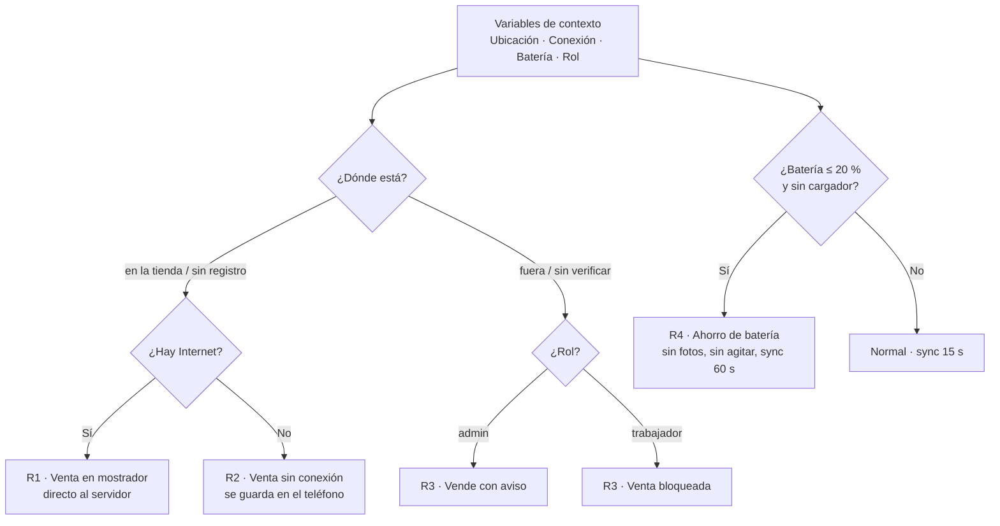
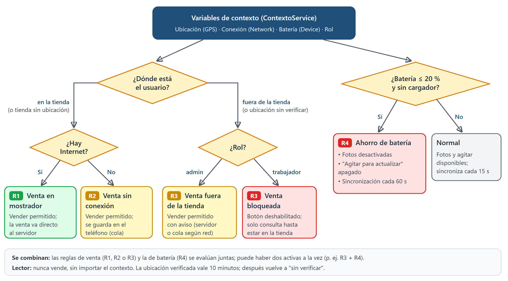

# Reglas de contexto

AbarrApp cambia su comportamiento según el contexto del usuario: dónde está respecto a la tienda, si hay Internet, cuánta batería le queda y qué rol tiene.

- **Motor de reglas:** [`shared/reglas.ts`](../mi-app-ionic/src/app/shared/reglas.ts). Son funciones puras, sin Angular, y tienen pruebas unitarias en `reglas.spec.ts`.
- **Variables:** las junta [`shared/contexto.service.ts`](../mi-app-ionic/src/app/shared/contexto.service.ts).
- **Pantalla:** la ruta `/reglas` muestra las variables en vivo, las reglas activas y el comportamiento resultante.

## Variables de contexto

| Variable | Fuente | Valores |
|---|---|---|
| Ubicación | GPS (Capacitor Geolocation), comparado con la ubicación registrada de la tienda (radio de 100 m) | `en_tienda`, `fuera`, `sin_verificar`, `sin_registro` |
| Conexión | Capacitor Network | con / sin Internet |
| Batería | Capacitor Device (`getBatteryInfo`), leída cada 60 s | 0–100 % y si está cargando |
| Rol | Rol del usuario en la tienda activa | `admin`, `trabajador`, `lector` |

Una ubicación verificada vale **10 minutos**; después vuelve a `sin_verificar`. Al abrir el punto de venta, la ubicación se verifica sola si el permiso ya está concedido.

## Reglas

| Regla | SI | ENTONCES |
|---|---|---|
| **R1** Venta en mostrador | Está en la tienda **y** hay conexión | Puede vender; la venta va directo al servidor |
| **R2** Venta sin conexión | Está en la tienda **y** no hay conexión | Puede vender; la venta se guarda en el teléfono y se envía al volver Internet |
| **R3** Fuera de la tienda | Está fuera de la tienda **o** su ubicación no está verificada | Trabajador: la venta se bloquea (solo consulta). Admin: puede vender, con un aviso |
| **R4** Ahorro de batería | Batería ≤ 20 % **y** no está cargando | Se desactivan las fotos y "agitar para actualizar", y la sincronización automática pasa de cada 15 s a cada 60 s |

- **Si la tienda no tiene ubicación registrada** (`sin_registro`), cuenta como "en la tienda", porque no hay contra qué comparar.
- **Las reglas se combinan:** R1, R2 y R3 deciden la venta, y R4 se evalúa aparte, así que puede haber dos reglas activas a la vez (por ejemplo, R3 + R4).
- **El lector nunca vende**, sin importar el contexto.

## Diagrama





## Escenarios probados en el emulador

| # | Contexto | Reglas | Resultado |
|---|---|---|---|
| 1 | Trabajador en la tienda, con Internet | R1 | Vende; "Venta registrada: $18.00" |
| 2 | Trabajador en la tienda, en modo avión | R2 | Vende; la venta se guarda en el teléfono y se sincroniza al volver la red |
| 3 | Trabajador a 1.5 km de la tienda | R3 | "Venta bloqueada" y botón deshabilitado |
| 4 | Trabajador fuera, batería al 15 % | R3 + R4 | Venta bloqueada, fotos y agitar apagados, sincronización cada 60 s |
| 5 | Admin fuera, batería al 15 % | R3 + R4 | Vende con aviso; en Productos los botones de foto están deshabilitados |

Además, hay 12 pruebas unitarias del motor de reglas:

```
npx ng test --watch=false --include src/app/shared/reglas.spec.ts
```
